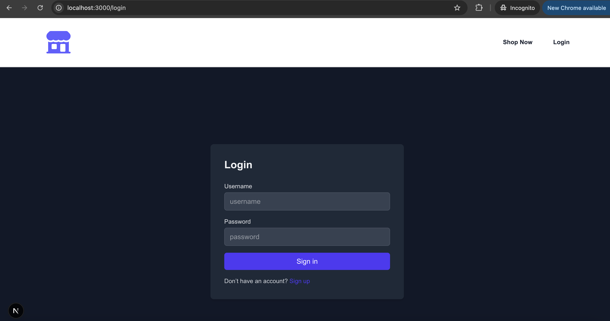
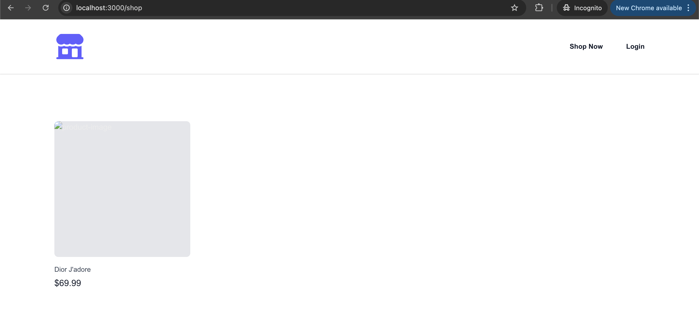

# Login Pass

user: syedali.ahmed@systemsltd.com
pass: Test.1234

# Ecom Storefront

Description: A customer-facing (B2C) e-commerce storefront built with Next.js and Supabase.
Core Features:
* Supabase Auth (register/login/logout) for customers.
* Public product catalog with categories (`/shop`, `/product/[productId]`).
* Cart (add, update quantity, remove items) tied to the signed-in user.
* Checkout flow that collects a shipping address and creates an order.
* Order history (`/orders`) and order detail/confirmation pages.
* Zod validation for login, registration, and checkout forms.
* Route protection for `/cart`, `/checkout`, and `/orders` via middleware.

## Setup

1. Create a Supabase project.
2. Run the SQL files in [supabase/sql](supabase/sql) in order (see that folder's README) to create tables, triggers, RLS policies, and seed data.
3. Copy `.env.example` to `.env.local` and fill in your Supabase project URL and anon key from Project Settings -> API.
4. `yarn install` then `yarn dev`.

# Login Page

# Guest User Shop View
*** View ***

# Empty Product List View

